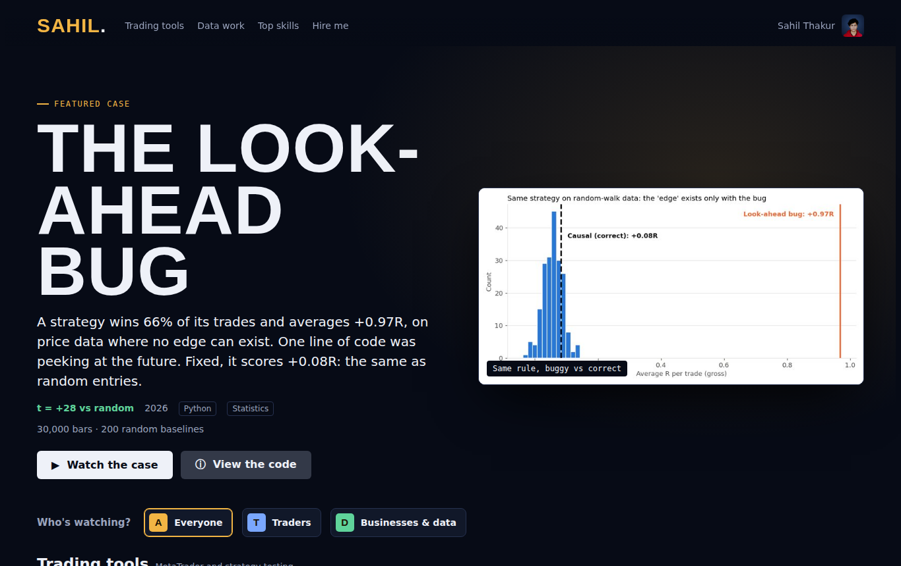
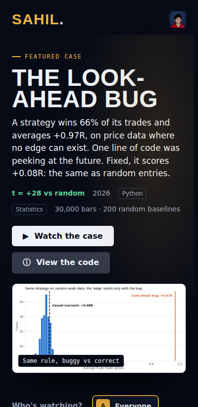

# Sahil Thakur: Trading Software & Data Portfolio

My projects, skills and way of working, presented like a streaming app.

**Live site:** https://sarru991.github.io

- **Featured case:** the look-ahead bug that made a no-edge strategy look like a 66% winner
- **"Who's watching?":** pick Traders or Businesses & data and the project shelves reorder for you
- **Project shelves:** trading tools, data work and research, each opening a detail panel with key results and a link to the code
- **Top 5 skills** and **how I work**, step by step

Built as a single self-contained HTML file: hand-written HTML, CSS and JavaScript, no framework, images embedded, responsive down to phone width.

---

**Sahil T.**, trading software developer and Python data analyst. Available on Upwork and Fiverr.

**License:** All rights reserved. Published for viewing only; see [LICENSE](LICENSE).
